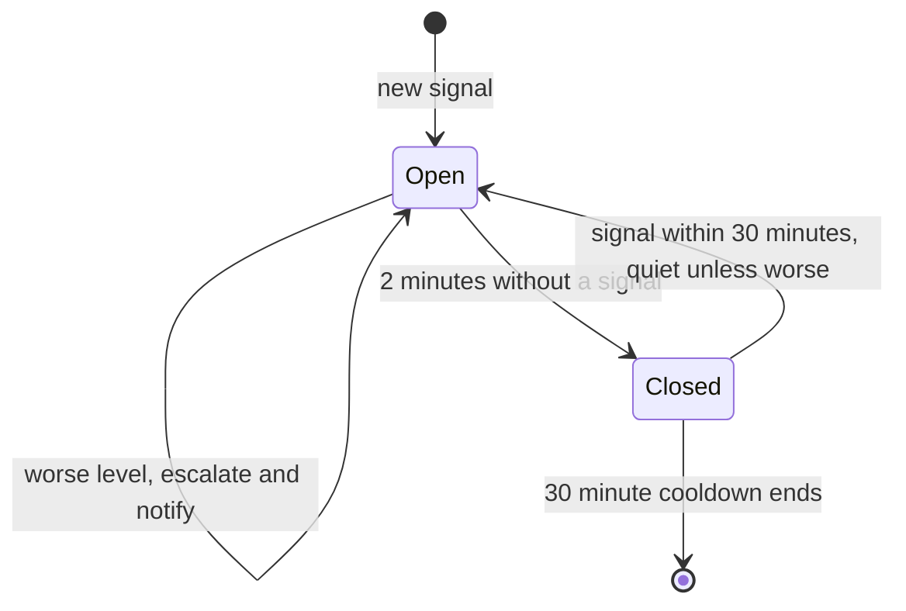
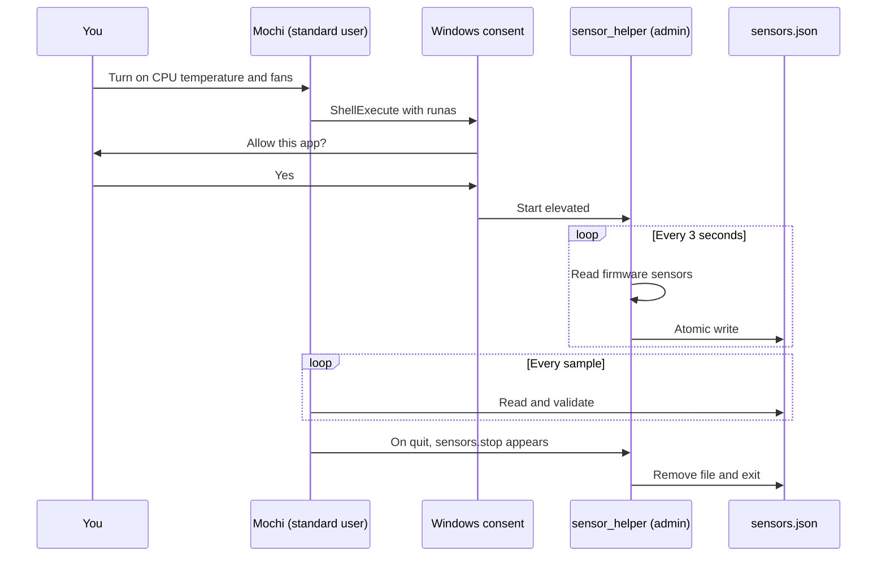

# Mochi: Technical Specification

| | |
| --- | --- |
| **Product** | Mochi, a baseline-aware PC health buddy |
| **Version** | 0.1.0 (database schema v3) |
| **Platform** | Windows 10/11 (full feature set); Linux and macOS through a best-effort adapter that is untested |
| **Stack** | Python 3.11+, PySide6, pyqtgraph, psutil, pywin32, SQLite |
| **Repository** | <https://github.com/RoyceRRNS/Mochi> |
| **Checked against the code** | 31 October 2026, commit `546ab9e` |

This document describes what Mochi does and exactly how it does it. Every threshold and default here comes from the code. Where a feature is incomplete or has only been tested in simulation, the text says so, and [section 28](#28-known-limitations) collects those gaps in one place.

Identifiers such as `DET-2` and `LIF-4` in the source code refer to requirements in [Mochi - Critique and Acceptance Criteria.md](Mochi%20-%20Critique%20and%20Acceptance%20Criteria.md). [Appendix B](#appendix-b-requirement-prefixes) lists the prefixes.

## Contents

1. [Purpose and scope](#1-purpose-and-scope)
2. [Feature catalogue](#2-feature-catalogue)
3. [Architecture](#3-architecture)
4. [The life of one sample](#4-the-life-of-one-sample)
5. [Data collection](#5-data-collection)
6. [Context and baselines](#6-context-and-baselines)
7. [Anomaly detection](#7-anomaly-detection)
8. [Trend detectors](#8-trend-detectors)
9. [Diagnosis](#9-diagnosis)
10. [Alerts](#10-alerts)
11. [Feedback](#11-feedback)
12. [Actions](#12-actions)
13. [Moods and the mascot](#13-moods-and-the-mascot)
14. [GPU, temperature and fan sensors](#14-gpu-temperature-and-fan-sensors)
15. [App startup timing](#15-app-startup-timing)
16. [Speed test and Health Score](#16-speed-test-and-health-score)
17. [Guided PC check](#17-guided-pc-check)
18. [Biggest-folder scan](#18-biggest-folder-scan)
19. [Quirks](#19-quirks)
20. [User interface](#20-user-interface)
21. [Storage](#21-storage)
22. [Lifecycle and resilience](#22-lifecycle-and-resilience)
23. [Security and privacy](#23-security-and-privacy)
24. [Configuration reference](#24-configuration-reference)
25. [Performance](#25-performance)
26. [Testing](#26-testing)
27. [Extending Mochi](#27-extending-mochi)
28. [Known limitations](#28-known-limitations)
- [Appendix A: Glossary](#appendix-a-glossary)
- [Appendix B: Requirement prefixes](#appendix-b-requirement-prefixes)

---

## 1. Purpose and scope

### The problem

Task Manager shows numbers, but it doesn't say whether they are unusual for this PC, why they changed, or what to do. A fixed rule such as "alert above 80% memory" is wrong for most people: 80% is ordinary on a browser-heavy laptop and alarming on an idle desktop.

### What Mochi does

Mochi runs in the system tray, samples the OS every 5 seconds, and learns what normal looks like on this PC for each hour of the day and each activity. When a reading stays above that normal, it explains the cause in plain language, names the culprit, and gives one tip. A mascot shows the state of the PC at a glance.

### Goals

- Compare the PC with its own history, not with fixed limits.
- Raise one alert per problem, with a cause, a culprit and a tip.
- Stay quiet during heavy use that is normal for that time and activity.
- Use little CPU and memory, and need no admin rights for the core features.
- Keep all data on the PC.

### Non-goals

- Mochi is not an antivirus. "Unfamiliar" never means malicious.
- It never ends a process or changes a setting without being asked.
- It doesn't manage fleets of PCs, and it has no cloud service, account or telemetry.
- It doesn't tune or overclock hardware, and it doesn't control fans.

### Design principles

| Principle | How it shows up |
| --- | --- |
| Your own normal | Baselines per hour of the day, weekday or weekend, and activity |
| One problem, one alert | Episodes keyed by culprit; escalation updates the same episode |
| Only claim what was measured | Every number in an alert comes from live data; a missing reading shows a reason, never 0 |
| Ask before acting | Actions need a click; ending a process needs a confirmation |
| Least privilege | The core runs without admin; admin-only sensors live in a separate, optional, read-only process |
| Keep working | Bad settings, dead threads and damaged databases are handled without stopping Mochi |

---

## 2. Feature catalogue

"Where" says where the feature appears. "Code" is the main module under `mochi/`. Features marked **[S]** are stretch goals from the acceptance criteria; all of them are implemented.

### Monitoring

| Feature | What it does | Where | Code |
| --- | --- | --- | --- |
| System sampling | CPU, memory, paging, disk, battery drain and more every 5 s | Home, Timeline | `platform/windows.py`, `collector.py` |
| Whole-system process read | Every process from one `NtQuerySystemInformation` call | Detective, alerts | `platform/windows.py` |
| App grouping | Combines processes into apps; splits interpreters by script | Detective, alerts | `grouping.py` |
| Activity detection | Classifies what you're doing from the foreground app | Home caption, buckets | `activity.py` |
| Editable app mapping | Assign any exe to browsing, coding, gaming, media or office | Settings > App activities | `activity.py` |
| Shared idle definition | One rule for "you're away", used everywhere | Everywhere | `activity.py` |
| Unavailable readings | Missing readings carry a reason and are never recorded as 0 | Home tiles, Timeline | `model.py` |

### Learning and detection

| Feature | What it does | Where | Code |
| --- | --- | --- | --- |
| Contextual baselines | Rolling mean and variance per time slot and activity | Timeline band, gauges | `baseline.py`, `buckets.py` |
| Fallback buckets | Uses a broader context until a specific one is trusted | Nerd stats | `baseline.py` |
| Contamination guard | Anomalous readings never enter the baseline | Automatic | `detector.py` |
| Delayed commit | Baseline updates wait 20 minutes so they can be undone | Automatic | `baseline.py` |
| New normal | Learns a lasting change after 3 days, or on request | Inbox notice, alert menu | `baseline.py`, `feedback.py` |
| Learning mode | Absolute limits and trends only for the first 3 days | Home, Settings | `engine.py` |
| Sustained z-score detection | Three levels, each needing a sustained rise | Alerts | `detector.py` |
| Practical floors | A reading must also be high in absolute terms | Alerts | `detector.py` |
| Absolute limits | Safety rules that apply regardless of baselines | Alerts | `detector.py` |
| Sensitivity slider | Five steps from Chill to Watchful | Settings > Alerts | `config.py` |
| Leak detection | Steady memory growth with no real drops | Alerts, Detective | `trends.py` |
| Disk-fill projection | Warns before a drive fills up | Alerts | `trends.py` |
| Runaway process detection | One process pinned for 5 minutes, even if system CPU looks low | Alerts | `trends.py` |

### Explanation and alerts

| Feature | What it does | Where | Code |
| --- | --- | --- | --- |
| Rule-based diagnosis | Ten ordered rules produce a cause, culprit and tip | Alerts | `diagnosis.py` |
| Plain-language fallback | Honest "I can't pin this down" text when no rule matches | Alerts | `diagnosis.py` |
| VM awareness | Explains that work inside WSL, Docker or a VM can't be seen into | Alert tips | `diagnosis.py` |
| Known maintenance | Recognises Defender, Windows Update, Search and similar work | Alert tips | `grouping.py` |
| Unfamiliar file check | Reports publisher, signature and location without calling anything malware | Alert tips | `platform/base.py` |
| Alert levels | Psst, Heads up and Uh-oh | Everywhere | `model.py`, `alerts.py` |
| Episodes | Dedupe, escalate, close after 2 quiet minutes, 30-minute cooldown | Inbox | `alerts.py` |
| Daily popup cap | At most 5 Heads-up popups a day | Automatic | `alerts.py` |
| Snooze | 1 hour, or until 08:00 tomorrow | Settings, tray | `engine.py` |
| Shh mode | Holds alerts during full-screen apps and Do Not Disturb, then summarises | Popup | `alerts.py` |
| Popups with buttons | Mochi's own non-focus-stealing windows near the tray | Desktop | `ui/popup.py` |
| Inbox | Ongoing and recent alerts plus suggestions | Home | `ui/screens/home.py` |
| Badge | Dot on the tray icon and count on the bell | Tray, header | `ui/tray.py`, `ui/main_window.py` |

### Feedback and actions

| Feature | What it does | Where | Code |
| --- | --- | --- | --- |
| "I meant to do that" | Removes the episode from the baseline and stays quiet for 30 days | Popup, Inbox | `feedback.py` |
| Undo quiet rules | Lists suppressions and lets you remove them | Settings | `feedback.py` |
| "Not a problem" | Records the opinion without changing behaviour | Popup, Inbox | `feedback.py` |
| "This is my new normal" | Restarts learning for that context | Inbox menu | `feedback.py` |
| End a process | Asks it to close, then ends it after 5 s | Alerts, Detective | `actions.py` |
| Let it run slower | Lowers the process priority | Alerts, Detective | `actions.py` |
| Where is it? | Opens the program's folder | Alerts, Detective | `actions.py` |

### Sensors

| Feature | What it does | Where | Code |
| --- | --- | --- | --- |
| GPU load | Busiest engine, matching Task Manager | Home tile, Timeline | `platform/windows.py` |
| GPU memory | Dedicated memory in use and in total | Home tile | `platform/windows.py` |
| GPU temperature | From the graphics driver; never wakes a sleeping GPU | Home tile, Timeline | `platform/windows.py` |
| CPU temperature | From LibreHardwareMonitor or Lenovo firmware through the helper | Home tile, Timeline, alerts | `sensors.py` |
| Fan speed | Same sources; see the [limitation on Lenovo fan readings](#28-known-limitations) | Home tile, Timeline | `sensors.py` |
| Optional admin helper | Read-only elevated process, approved through Windows' consent prompt | Settings, Home, Timeline | `sensor_helper.py` |

### Mood

| Feature | What it does | Where | Code |
| --- | --- | --- | --- |
| Eight moods | Happy, Sleepy, Puffy, Sweaty, Dizzy, Grumpy, Zoomies, Proud | Home, tray, popups | `moods.py` |
| Fast reaction | Reacts in about 30 s, well before the 5-minute alert | Home, tray | `moods.py` |
| Drawn mascot | Painted from shapes, so it scales from 16 px to 220 px | Everywhere | `ui/mascot.py` |
| Poke Mochi | Click or press Space for a quick status | Home | `ui/screens/home.py` |

### Tasks and quirks

| Feature | What it does | Where | Code |
| --- | --- | --- | --- |
| App startup timing **[S]** | Times launches and spots apps getting slower | Inbox notice, records | `startup_tracker.py` |
| Speed test **[S]** | CPU, memory and unbuffered disk benchmarks in a separate process | Check-up | `bench_worker.py` |
| Health Score **[S]** | 0 to 100 against this PC's own early runs | Check-up | `benchmarks.py` |
| Automatic speed tests **[S]** | Daily for 14 days, then weekly, when you're away and plugged in | Automatic | `benchmarks.py` |
| Guided PC check **[S]** | Eight checks with a report card and top three suggestions | Check-up | `checkup.py` |
| Biggest folders | Safe scan that never follows links or downloads cloud files | Check-up | `folderscan.py` |
| Daily PC weather **[S]** | A one-line forecast from real history | Home | `quirks.py` |
| OS fact of the day **[S]** | Today's context switches and interrupts | Home | `quirks.py` |
| Feed Mochi **[S]** | A snack when you close an app Mochi named | Popup, Diary | `quirks.py` |
| Gentle roasts **[S]** | Optional, off by default, based only on measurable facts | Home | `quirks.py` |
| Achievements **[S]** | Six badges tied to real metrics | Diary | `quirks.py` |
| Calm streak **[S]** | Days in a row without an Uh-oh | Home, Diary | `quirks.py` |
| Mochi's diary **[S]** | Weekly entries from templates, offline | Diary | `quirks.py` |
| Personal records **[S]** | Fastest boot, longest uptime and more | Diary | `quirks.py` |
| Boot timing **[S]** | Measures boot when Mochi starts at sign-in | Records | `quirks.py` |

### Data, reliability and desktop

| Feature | What it does | Where | Code |
| --- | --- | --- | --- |
| Local SQLite store | WAL mode, batched commits, one writer thread | Automatic | `storage.py` |
| Retention | Raw 14 days, minute averages 90 days, hourly forever | Settings | `storage.py` |
| Export | Every table as CSV plus a summary | Settings > Your data | `storage.py` |
| Delete all my data | Removes every row and shrinks the file | Settings > Your data | `storage.py` |
| Damaged-database recovery | Salvages readable rows at startup and keeps the original | Inbox notice | `recovery.py` |
| Thread supervision | Restarts a dead worker within about 2 s | Banner if stale | `engine.py` |
| Sleep and clock handling | Gaps reset detection and start a grace period | Automatic | `detector.py` |
| Single instance | A second launch shows the existing window | Automatic | `instance.py`, `ui/app.py` |
| Graceful quit command | `python -m mochi --quit` | Command line | `ui/app.py` |
| Start at sign-in | Per-user Run key, no admin | Onboarding, Settings | `autostart.py` |
| Tray icon | Live mood face, menu and tooltip | Taskbar | `ui/tray.py` |
| Light and dark themes | Follows Windows or a manual choice | Settings | `ui/theme.py` |
| Accessibility | Screen-reader names, keyboard use, reduced motion, high contrast, checked contrast | Everywhere | `ui/` |
| Onboarding | Four-step welcome | First run | `ui/onboarding.py` |
| Nerd stats | z-scores, bands, buckets and Mochi's own usage | Header toggle | `ui/main_window.py` |
| Demo mode | Much shorter waits, clearly labelled | Settings, `--demo` | `config.py` |
| Simulated mode | The full UI on scripted data | `--simulate` | `ui/app.py`, `replay.py` |
| Profiles | Separate data folders | `--profile` | `paths.py` |

---

## 3. Architecture

### Overview

```mermaid
flowchart TB
    OS["Windows APIs"] --> PLAT["Platform adapter"]
    HELPER["Optional admin helper"] -.->|"sensors.json"| COLL
    PLAT --> COLL["Collector thread<br/>every 5 s"]
    COLL -->|"bounded queue"| PROC["Processing thread"]
    PROC --> BASE["Baselines"]
    PROC --> DET["Detector"]
    PROC --> TREND["Trends"]
    DET --> DIAG["Diagnosis"]
    TREND --> DIAG
    DIAG --> ALERT["Alert manager"]
    PROC --> MOOD["Mood engine"]
    PROC -->|"writes"| WRITER["Storage writer thread"]
    WRITER --> DB[("SQLite")]
    ALERT --> BRIDGE["Engine bridge"]
    MOOD --> BRIDGE
    BRIDGE -->|"Qt signals"| UI["Window, tray, popups"]
    SUP["Supervisor thread"] -.->|"restarts"| COLL
    SUP -.->|"restarts"| PROC
```



### Layers

| Layer | Modules | Rule |
| --- | --- | --- |
| OS adapters | `platform/` (`base`, `windows`, `generic`, `fake`) | System readings and actions behind one interface. The startup watcher and sensor readers are the exceptions: they use `psutil` and WMI directly |
| Plain data | `model.py` | No OS or Qt imports |
| Pure logic | `baseline`, `detector`, `trends`, `diagnosis`, `alerts`, `feedback`, `moods`, `quirks`, `activity`, `buckets`, `grouping` | No Qt, and testable without a real PC |
| Services | `engine`, `collector`, `storage`, `recovery`, `actions`, `folderscan`, `benchmarks`, `checkup`, `startup_tracker`, `sensors`, `autostart`, `instance` | Coordinate work, threads and files |
| User interface | `ui/` | Talks to the engine through `EngineBridge` and engine methods |

Because `FakePlatform` implements the same interface as `WindowsPlatform`, the simulated end-to-end tests run the production pipeline unchanged.

### Threads

| Thread | Started by | Job |
| --- | --- | --- |
| Main (GUI) | Qt | All widgets, tray and popups |
| `mochi-collector` | `Engine.start` | Samples on fixed ticks and fills the queue |
| `mochi-processing` | `Engine.start` | Runs `process_sample` for each queued sample |
| `mochi-supervisor` | `Engine.start` | Every 2 s restarts dead workers and publishes status |
| `mochi-storage` | `Storage` | The only thread that writes to SQLite |
| `mochi-startup` | `Engine.start` (Windows) | Watches for app launches |
| `mochi-sensor-launch` | `SensorHelper.start` | Starts the helper; can wait on Windows' consent prompt |
| `mochi-bench` | Scheduler | A scheduled speed test |
| `mochi-folderscan` | `FolderScanner` | A biggest-folder scan |
| `mochi-ui-task` | `EngineBridge.run_async` | Slow work requested by the UI |

The collector and processing threads form a producer-consumer pair joined by a bounded queue of 120 samples, which is 10 minutes of readings. If processing falls that far behind, the oldest sample is dropped and counted. Sampling itself is never blocked.

### Processes

| Process | Privilege | Lifetime |
| --- | --- | --- |
| Mochi (`python -m mochi`) | Standard user | Until quit |
| `mochi.bench_worker` | Standard user | One speed test or load test |
| `mochi.sensor_helper` | Administrator, optional | Exits when Mochi exits |

Python's GIL would make a benchmark in a thread freeze the UI and delay samples, which is why benchmarks run in their own process.

---

## 4. The life of one sample

Every sample follows the same path. `Engine.tick()` runs this path synchronously for simulations, so tests exercise the production code.

**On the collector thread** (`Collector.collect`):

1. Read all processes with one system call.
2. Read system counters, GPU and sensor values.
3. Name the foreground app from the process list.
4. Merge any fresh readings from the sensor helper.
5. Turn cumulative counters into rates, using the previous reading of each `(pid, create_time)`.
6. Group processes into apps and derive the nine baseline metrics.
7. Put the sample in the queue.

**On the processing thread** (`Engine.process_sample`, all under one lock):

8. Classify the activity and smooth it over 60 s, then compute the time slot and calendar day.
9. Decide whether this is learning mode, Mochi's own benchmark activity, or the post-boot grace period.
10. Run the detector: compute a z-score against the baseline, update the sustain trackers, queue a baseline update unless the guard blocks it, and evaluate absolute limits.
11. Update the runaway tracker. Once a minute, also update leak and disk history and save app and volume snapshots.
12. Every 5 minutes, re-evaluate the leak and disk-fill trends.
13. Build a diagnosis context and pass all signals to the alert manager, which diagnoses them and opens, escalates, reopens or closes episodes.
14. Credit any snack, then compute the mood.
15. Commit baseline updates that have waited 20 minutes.
16. Save the sample. Save changed baselines once a minute. Run hourly work when the hour changes.
17. Record boot timing, refresh learning progress every 10 minutes, and check the benchmark schedule every 5 minutes.
18. Build a `SampleView`, a snapshot for the UI.

**After the lock is released**, events are published. `EngineBridge` re-emits them as Qt signals, so UI updates run on the GUI thread.

---

## 5. Data collection

### Baseline metrics

These nine metrics are stored with their usual band and appear on the Timeline. The first six can raise alerts. The last three, called watch metrics, learn a band but never raise an alert themselves.

| Key | Meaning | Unit | Windows source | Sigma floor | Minimum rise | Alerts |
| --- | --- | --- | --- | --- | --- | --- |
| `cpu` | CPU across all cores | % | `psutil.cpu_percent` per core, averaged | 3 | 15 | Yes |
| `ram` | Memory in use | GB | `psutil.virtual_memory` (total minus available) | 0.25, or 3% of RAM if larger | 1 | Yes |
| `paging` | Hard page reads | pages/s | PDH `\Memory\Pages Input/sec` | 20 | 200 | Yes |
| `disk` | Busiest physical disk | % | PDH `\PhysicalDisk(*)\% Idle Time` (100 minus the lowest) | 5 | 25 | Yes |
| `temp` | CPU temperature | °C | See [section 14](#14-gpu-temperature-and-fan-sensors) | 2 | 8 | Yes |
| `discharge` | Battery drain, only on battery | W | `CallNtPowerInformation(SystemBatteryState)` | 1 | 5 | Yes |
| `gpu` | Busiest GPU engine | % | PDH `\GPU Engine(*)\Utilization Percentage` | 3 | 15 | No |
| `gpu_temp` | GPU temperature | °C | See [section 14](#14-gpu-temperature-and-fan-sensors) | 2 | 8 | No |
| `fan` | Fastest fan | RPM | See [section 14](#14-gpu-temperature-and-fan-sensors) | 150 | 500 | No |

### Other system readings

| Reading | Source | Used for |
| --- | --- | --- |
| Commit charge % | PDH `\Memory\% Committed Bytes In Use` | Memory pressure |
| Disk latency | PDH `Avg. Disk sec/Transfer`, worst disk | Disk bottleneck |
| Disk queue, read and write rates | PDH `\PhysicalDisk(_Total)\...` | Nerd detail; queue is stored |
| CPU performance % | PDH `\Processor Information(_Total)\% Processor Performance` | Throttling |
| Performance limit % | PDH `...\% Performance Limit` | Throttling (100 means not limited) |
| Run queue | PDH `\System\Processor Queue Length` | Stored |
| Context switches, interrupts, system calls | `psutil.cpu_stats` | OS fact of the day |
| Idle time | `GetLastInputInfo` | Idle detection |
| Foreground app | `GetForegroundWindow`, process list | Activity |
| Full screen, Do Not Disturb, locked | `SHQueryUserNotificationState`, window rectangle | Quiet modes, idle |
| Free space per fixed drive | `psutil.disk_usage` | Storage rules |
| Battery percent and power source | `CallNtPowerInformation`, `psutil` | Discharge, speed-test scheduling |

### Reading processes

`psutil` needs per-process handles, costs about 430 ms of CPU per scan here, and hits Access Denied on protected processes. Mochi instead makes one `NtQuerySystemInformation(SystemProcessInformation)` call, which returns all of this for every process with no handles: name, PID, parent PID, create time, CPU time, private bytes, private working set, I/O transfer counts, hard faults and thread count.

A process is identified by `(pid, create_time)`, because Windows reuses PIDs. Rates come from the difference between two readings. A process that started since the last sample has its counters averaged over its short life. CPU is capped at 100% times the number of logical CPUs.

Only the top 15 processes by CPU plus the top 15 by memory are stored per sample. All apps are snapshotted once a minute.

### Grouping into apps

- All processes with the same exe name become one app. Memory is the sum of private bytes, which doesn't double-count shared pages.
- Helper processes (`msedgewebview2.exe`, `conhost.exe`, `crashpad_handler.exe`) join the app that started them.
- Interpreters (`python.exe`, `node.exe`, `java.exe`, `powershell.exe` and others) are split by script, giving names like `python.exe (memory_hog.py)`. Only the basename is kept.
- Mochi and anything it starts are tagged as self and excluded from culprit selection. A process tree walk goes up to 12 levels, and a parent that started after its child is ignored as a reused PID.

### Activity and idle

The foreground exe maps to one of `browsing`, `coding`, `gaming`, `media` or `office`, through a JSON file you can edit in Settings. Anything else is `other`, unless the exe runs from a known game folder or Windows reports a Direct3D full-screen app, which counts as `gaming`.

The class is smoothed to the dominant value over the last 60 s (ties go to the most recent), so alt-tabbing doesn't flip contexts.

One shared rule defines `idle`, the seventh class:

> Locked, **or** no keyboard or mouse input for 10 minutes while not full screen and with no media or game in front.

Watching a film or playing with a gamepad therefore never counts as idle.

### Unavailable readings

A reading that can't be taken is `None` with a human reason in `SystemRaw.unavailable`. It is never stored as 0 and is skipped by the detector. The screens show the reason.

---

## 6. Context and baselines

### Buckets

A sample belongs to one time slot and one activity. A slot is the local hour, with weekend hours numbered 24 to 47, giving 48 slots. With 7 activities that makes 336 specific buckets. Every sample also updates two broader buckets:

| Level | Key example | Lookup order |
| --- | --- | --- |
| Slot and activity | `s10\|coding` | First |
| Activity | `*\|coding` | Second |
| Global | `*\|*` | Last |

A lookup returns the first trusted bucket in that order. The metric is stored per bucket, so each of the nine metrics has its own statistics.

### Rolling statistics

Each bucket and metric keeps an exponentially weighted mean and variance, with `alpha = 0.01`:

```
a    = max(alpha, 1 / (n + 1))
d    = x - mean
mean = mean + a * d
var  = (1 - a) * (var + a * d * d)
n    = n + 1
```

Taking the larger of `alpha` and `1 / (n + 1)` makes early values a plain running average instead of decaying from zero.

### Trust

A bucket is trusted after at least 30 samples on at least 2 different days. Thirty samples from one afternoon would describe that afternoon, not a habit.

### Contamination guard

A plain rolling average updated on every sample absorbs a sustained plateau within about a minute, so no 2- or 5-minute alert could ever fire. Mochi therefore does not learn from a reading if any of these is true:

- An alert signal is active for that metric.
- The reading is more than 2 standard deviations above the mean of the best available bucket (one with at least 10 samples) and rose by at least half the metric's minimum rise.
- The sample is quiet: during grace periods or Mochi's own benchmarks.

### Delayed commit

Accepted readings wait in a queue for 20 minutes before they update the baseline. This is what makes "I meant to do that" exact: removing pending readings inside an episode gives the same baseline as if the episode never happened.

### New normal

If readings are held back on 3 different days within a week, Mochi accepts the change. It forgets the bucket's values, keeps its most recent day so it becomes trusted again quickly, and posts an inbox notice.

Choosing "This is my new normal" does the same at once for the slot-and-activity and activity buckets. The global bucket is left alone.

### Learning mode and progress

For the first 3 days after the first sample, z-score alerts and the runaway rule are off. Baselines still learn, and absolute limits and objective trends still run.

Learning progress is the share of your non-idle time in the last 7 days spent in contexts whose CPU bucket is trusted. It is recalculated every 10 minutes.

---

## 7. Anomaly detection

### z-score signals

For each alerting metric, the detector uses the mean and standard deviation from before this sample:

```
sigma = max(bucket std, sigma floor)
z     = (x - mean) / sigma
```

A reading meets a level when all of these hold:

1. A trusted baseline exists and Mochi isn't in learning mode.
2. The reading is above normal by at least the metric's minimum rise. Only high readings count.
3. `z` is above that level's threshold for the current sensitivity.
4. The reading passes that level's practical floor.

| Sensitivity | Psst | Heads up | Uh-oh |
| --- | --- | --- | --- |
| Chill | 2.5 | 3.5 | 4.5 |
| Relaxed | 2.25 | 3.25 | 4.25 |
| **Balanced** (default) | 2.0 | 3.0 | 4.0 |
| Alert | 1.75 | 2.75 | 3.75 |
| Watchful | 1.5 | 2.5 | 3.5 |

### Sustain

A level fires only when at least 80% of samples in its window reach it, so a brief dip doesn't reset the clock and a brief spike can't alert.

| Level | Window | In demo mode |
| --- | --- | --- |
| Psst | 2 minutes | 20 s |
| Heads up | 5 minutes | 45 s |
| Uh-oh | 5 minutes | 60 s |

### Practical floors

z-scores on steady metrics get huge for small changes, so opening one big app could otherwise be an Uh-oh. Heads up and Uh-oh also need a reading that is high in absolute terms. Psst is purely statistical.

| Metric | Heads up needs | Uh-oh needs |
| --- | --- | --- |
| `cpu` | at least 30% | at least 85% |
| `ram` | at least 60% of RAM in use | at least 85% |
| `paging` | at least 100 pages/s | at least 500 pages/s |
| `disk` | at least 50% busy | at least 90% busy |
| `temp` | within 25 °C of the limit | within 10 °C of the limit |
| `discharge` | at least 10 W | at least 25 W |

The CPU temperature limit `tjmax_c` defaults to 100 °C.

### Absolute limits

These run on every sample, with or without baselines.

| Rule | Metric | Level | Held for | Condition |
| --- | --- | --- | --- | --- |
| `ram_critical` | `ram` | Uh-oh | 60 s | Under 5% of RAM available |
| `temp_high` | `temp` | Uh-oh | 30 s | CPU within 5 °C of the limit |
| `throttle` | `cpu` | Heads up | 120 s | CPU at least 50% and performance limit under 85% |
| `cpu_pegged` | `cpu` | Heads up | 600 s | CPU at least 95% (learning only) |
| `paging_storm` | `paging` | Heads up | 120 s | At least 2000 pages/s and under 10% available (learning only) |
| `disk_busy_abs` | `disk` | Heads up | 300 s | Disk at least 98% busy (learning only) |
| `disk_full` | `disk_free` | Uh-oh | Immediate | Under 5% free or under 5 GB, per fixed drive |
| `disk_low` | `disk_free` | Heads up | Immediate | Under 10% free and under 20 GB, per fixed drive |

"Learning only" rules stand in for baselines: they apply during learning mode, or when the metric has no trusted baseline, and switch off once it does.

### Quiet periods

During the times below, sustain trackers reset, nothing is learned, trend and runaway signals are held back, and absolute rules below Uh-oh pause. Drive-space rules keep running.

| Quiet period | Length |
| --- | --- |
| After boot | 5 minutes |
| After a gap (see below) | 3 minutes |
| During Mochi's benchmarks and load tests | The run, plus 30 s |

A gap is more than 15 s between samples on either clock, or the wall clock moving backwards by over a second. That covers sleep, hibernation and manual clock changes. Gaps also reset the activity smoother.

---

## 8. Trend detectors

Slow problems rarely trip a z-score, so these look at slopes. They run every 5 minutes on data recorded once a minute. Trends and absolute limits run during learning mode.

### Memory leak

For each non-system app, Mochi keeps up to 4 hours of private memory. It looks only at the stretch since the last real drop (over 10% below the peak), then fits a straight line by least squares.

A finding needs an `r²` of at least 0.8, no drop over 10%, and a positive slope, plus either of:

| Kind | Needs |
| --- | --- |
| Fast leak | At least 15 minutes, at least 500 MB of growth, at least 100 MB/h |
| Slow leak | At least 60 minutes at at least 100 MB/h |

Apps that grow by design (browsers and IDEs in `grow_by_design`) need three times those amounts. `leak_ignore` lists apps that are skipped. Restarting an app clears its history. A leak raises a Heads up.

### Disk filling

For each fixed drive, Mochi keeps up to 24 hours of free space. It warns (Heads up) when the data covers at least 6 hours, free space is falling with an `r²` of at least 0.6, under 30% is free, and the drive would be full within 7 days at that rate.

### Runaway process

A stuck single-threaded script is only about 3% of a 32-thread CPU, so it never trips the system CPU baseline. The runaway tracker follows each process individually. It raises a Heads up when a process has held at least 90% of one core, or at least 50% of the machine, for at least 80% of the last 5 minutes.

The foreground app and Mochi are exempt, and the rule is off during learning mode.

---

## 9. Diagnosis

Signals say something is high. Diagnosis says why. Rules run in a fixed order and the first match wins. A rule only explains the metrics it lists, so a full disk can never "explain" a CPU spike.

The order matters. Memory pressure comes before disk I/O because paging is disk I/O, and a runaway process comes before throttling because the runaway causes the heat.

| Order | Rule | Title | Explains | Matches when | Culprit |
| --- | --- | --- | --- | --- | --- |
| 1 | `memory_pressure` | Memory pressure | ram, paging, disk, cpu | 30 s paging above max(3x usual, 100), or 500 with no baseline, and under 10% available or commit over 90% | Largest non-system app |
| 2 | `runaway` | Runaway process | cpu, temp, discharge | A runaway finding exists | That app |
| 3 | `disk_io` | Disk bottleneck | disk | 80% of the last 2 minutes at 90% busy or 50 ms latency | Top app by I/O |
| 4 | `leak` | Possible memory leak | ram | A leak finding exists | That app |
| 5 | `memory_hog` | Memory hog | ram | A z-score or absolute signal | Largest non-system app |
| 6 | `throttling` | Thermal throttling | cpu, temp | 30 s CPU at least 50% and limit under 85% or performance under 70%, or a temperature signal at the limit | None |
| 7 | `storage` | Disk space | disk_free | A drive-space signal | None (the drive) |
| 8 | `idle_cpu` | Busy while you're away | cpu | A z-score signal while you're idle | Top app by 2-minute CPU |
| 9 | `cpu_hog` | Busy CPU | cpu | One app holds at least 10% of the CPU and at least 40% of total use | That app |
| 10 | `battery` | Battery draining fast | discharge | A battery-drain signal | Top CPU app |
| - | `unknown` | Something's unusual | Anything else | No rule matched | None; lists the top three users |

Details worth noting:

- **Known maintenance.** `idle_cpu` and `runaway` recognise Defender, Windows Update, Windows Search, `.NET` optimisation and similar work, and say it's normal housekeeping.
- **Unfamiliar programs.** A program counts as unfamiliar if it runs from Temp or Downloads, or if it's outside the Windows folder, unsigned, and has no publisher. The text describes facts and never says "malware".
- **Virtual machines.** For `vmmem`, Docker, Hyper-V, VirtualBox and VMware hosts, the tip explains that Mochi can't see which program inside is busy.
- **System processes.** A system culprit is never offered "End", only "Let it run slower".
- **Caching.** A diagnosis is reused for 60 s per signal, so each sample doesn't repeat the work.

---

## 10. Alerts

### Levels

| Level | Title | Meaning | Default delivery |
| --- | --- | --- | --- |
| Psst | "Psst..." | Worth knowing | Badge only |
| Heads up | "Heads up!" | Probably affecting you | Popup, fades after 12 s |
| Uh-oh | "Uh-oh." | Act soon | Popup that stays until dismissed |

### Episodes

An episode groups everything about one problem. Its key is `("app", culprit)` when there's a culprit, otherwise `(rule, target)`. So a memory hog that turns into memory pressure stays one alert whose explanation sharpens. When several signals in one sample share a key, the highest level and the highest-ranked rule win.



### Delivery decision

Each time an episode opens or reaches a new highest level, Mochi decides how to deliver it:

| Situation | Psst | Heads up | Uh-oh |
| --- | --- | --- | --- |
| Suppressed by "I meant to do that" | Silent | Silent | Delivered as below |
| Normal | Badge | Popup | Popup |
| Snoozed | Badge | Held | Popup (`uh_oh_breaks_snooze`) |
| Full screen or Do Not Disturb (Shh mode) | Badge | Held | Popup |
| Daily cap of 5 reached | Badge | Inbox and badge | Popup |
| You dismissed this Uh-oh in the last 24 hours | n/a | n/a | Inbox and badge |

Only Heads-up popups count toward the daily cap. When a snooze or Shh mode ends, held alerts arrive together in one "While you were busy" popup.

### Notices

Notices are suggestions rather than problems. They appear in the Inbox, and most also arrive as a popup.

| Notice | When |
| --- | --- |
| I've learned a new normal | A baseline accepted a lasting change |
| Mind if I run a quick speed test? | Tests are overdue |
| Check-up time? | Two low Health Scores in a row |
| Apps are opening slower | At least 3 apps have slowed down |
| I patched up my notebook | A damaged database was salvaged |

---

## 11. Feedback

| Response | Effect |
| --- | --- |
| **I meant to do that** | Replies naming the app. Excludes the episode from the baseline, from before it opened (it started building up earlier) until it closes. Creates a suppression for that (app, metric, activity) lasting 30 days. Uh-oh still gets through. |
| **Not a problem** | Records the label only. Behaviour doesn't change. |
| **This is my new normal** | Restarts learning for that context. Offered for z-score alerts. |
| **Dismiss** | Clears it, and remembers an Uh-oh for 24 hours so it doesn't nag. |

Suppressions appear in Settings under "Things I keep quiet about", each with the days left and an Undo button.

---

## 12. Actions

Mochi never acts on its own. Every action is a click, and ending a process also needs a confirmation.

### Ending a process

1. Refuse system and protected processes, PIDs 0 and 4, and Mochi itself. Ending `csrss.exe` would crash Windows.
2. Check again that `(pid, create_time)` still matches, so a reused PID is never ended by mistake. This closes a classic time-of-check to time-of-use race.
3. Post `WM_CLOSE` to the app's visible windows so it can save.
4. Wait up to 5 s, checking every 0.25 s.
5. Only then terminate it.

### Other actions

| Action | How |
| --- | --- |
| Let it run slower | Sets `BELOW_NORMAL_PRIORITY_CLASS`, an OS scheduling change that is gentler than ending it |
| Where is it? | Opens Explorer with the file selected |
| Show biggest folders | Opens Check-up and starts a scan of that drive |
| Startup settings | Opens `ms-settings:startupapps` |

---

## 13. Moods and the mascot

Moods are a live summary that doesn't wait for the alert rules. They use a 15-second window.

| Precedence | Mood | Shown when | Label |
| --- | --- | --- | --- |
| 1 | Dizzy | A memory-pressure episode is open, or paging is high (z over 3 or at least 1000 pages/s) with under 15% available | Your PC is swapping memory to disk heavily. |
| 2 | Sweaty | CPU within 15 °C of the limit, or CPU at least 50% with the limit under 85%, or a throttling episode is open | The CPU is hot or slowing itself down. |
| 3 | Grumpy | A drive under 10% and under 20 GB free, or a storage episode is open | A drive is nearly full. |
| 4 | Puffy | Memory z over 2, or at least 90% of RAM in use | Memory use is well above your normal. |
| 5 | Zoomies | A speed test is running | I'm running a quick speed test. |
| 6 | Proud | Within 10 minutes of a snack, or a Health Score rise of more than 2 points | Things got better. Nice work! |
| 7 | Sleepy | You're idle and CPU is under 15% | You're away and your PC is resting. |
| 8 | Happy | Otherwise | Everything is within your normal. |

A mood applies when its condition holds in more than half of the window. Zoomies and Proud apply at once. A mood lasts at least 30 s, so it never flickers. Every mood has a plain-language label next to the mascot, so nothing relies on reading the face.

### The mascot

Mochi is painted from shapes (`ui/mascot.py`), so one painter draws the 220-pixel Home mascot, the popup face and the tray icon, which is simplified to just the face at 32 pixels and below. Each mood changes the eyes, mouth, body squash and one small prop. It's original artwork.

It breathes on a 3-second loop and squishes on a mood change or a poke. Animation stops when hidden, and follows reduced-motion settings.

---

## 14. GPU, temperature and fan sensors

### Sources

| Reading | Source | Admin? | Notes |
| --- | --- | --- | --- |
| GPU busy % | PDH `\GPU Engine(*)\Utilization Percentage` | No | Each engine's share summed over processes; the busiest engine is shown, as in Task Manager |
| GPU memory used | PDH `\GPU Adapter Memory(*)\Dedicated Usage` | No | Summed over adapters |
| GPU memory total | `D3DKMTQueryAdapterInfo` | No | Dedicated video memory; remembered while the GPU sleeps |
| GPU temperature | `D3DKMTQueryAdapterInfo`, adapter performance data | No | What Task Manager shows; needs a driver that reports it |
| GPU fan (desktops) | Same data | No | Added as "GPU fan" when the driver reports RPM above 0 |
| CPU temperature, fans | LibreHardwareMonitor's WMI sensors, if it's running | No | Preferred; read every 5 s, retried every 10 minutes if absent |
| CPU temperature, fans | Lenovo `LENOVO_GAMEZONE_DATA` WMI methods | Yes | Through the helper |
| CPU temperature | `MSAcpi_ThermalZoneTemperature` | Yes | Last resort; readings under 30 °C are rejected |

**Why GPU temperature doesn't use NVML.** NVIDIA's NVML library worked, but it added 19 MB of private memory, which pushed Mochi over its budget. `D3DKMTQueryAdapterInfo` lives in `gdi32`, already loaded, and takes about 0.1 ms.

**Why ACPI zones are distrusted.** Many laptops report a fixed placeholder. On the development laptop the zone stayed at exactly 27.9 °C under an 8-core load.

### Never waking a sleeping GPU

Polling a sleeping laptop GPU could wake it and keep it awake, wasting battery. Before every query, Mochi reads the adapter's power state through SetupAPI (`SPDRP_DEVICE_POWER_DATA`, about 0.4 ms), which doesn't touch the device. It matches adapters by PCI vendor and device ID. An adapter not in D0 is only identified, never queried, and the temperature tile says the GPU is asleep.

Microsoft's software renderer (`VEN_1414`) is skipped. When there are several GPUs, the one with the most dedicated memory is shown.

### The admin helper

On Lenovo laptops, Windows lets only administrators call the firmware sensor methods. Running all of Mochi as admin would break least privilege, so a tiny separate process does just this one job.



It's off by default. Turning it on is remembered, and Windows asks again each time Mochi starts. If Mochi itself runs as admin, the helper starts without a prompt. After a refusal, the Turn on buttons don't return until Mochi restarts or the Settings switch is turned off and on again.

| Helper state | Screens show |
| --- | --- |
| `off` | "Needs admin on this PC" with a Turn on button |
| `asking` | Waiting for Windows to give permission |
| `running`, first 30 s | The sensor helper is starting |
| `running`, no data after 30 s | The sensor helper isn't reporting |
| `declined` | Windows didn't give permission |
| `failed` | Couldn't start, with the code |

The feed is one small JSON file:

```json
{"ts": 1793438538.3, "source": "Lenovo sensors", "cpu_temp": 65.0, "gpu_temp": 48.0,
 "fans": [{"label": "Fan 1", "rpm": 2350.0, "max_rpm": 5400.0}]}
```

Mochi validates it on every read: a bad type, an implausible value or a reading older than 20 s counts as no reading. A vendor sensor beats an ACPI zone, but otherwise a reading from the platform wins, and LibreHardwareMonitor is trusted to list every fan.

### Helper safeguards

The helper runs as admin but writes into a folder that ordinary programs can change, so it treats that folder as hostile:

- It takes no commands. Its only inputs are its arguments and whether the stop file exists.
- It refuses any output file not named `sensors.json`, any relative path, and any folder that is a symlink or junction, or whose parent is. A planted junction can't redirect its writes.
- It writes a randomly named temp file created exclusively, which fails rather than following a planted link, then renames it into place.
- It exits when Mochi exits, when `sensors.stop` appears, or after 20 failed reads in a row.

### Verified on real hardware

On the development laptop (Intel i9-14900HX, RTX 4070 Laptop, Lenovo) the helper was approved and ran for about an hour of real use:

| Reading | Result |
| --- | --- |
| CPU temperature | Works: 47 to 95 °C |
| GPU temperature | Works when awake: up to 79 °C. While the GPU idles, 1 °C was recorded for about 10 minutes, which isn't a real temperature |
| Fan speed | **Doesn't work**: 0 RPM on both fans in all 725 readings, even at 95 °C |

See [Known limitations](#28-known-limitations).

---

## 15. App startup timing

Five-second sampling can't tell a 2.1 s launch from a 7.8 s one, so a watcher thread looks for new processes and checks their CPU about four times a second.

- **Ready** means the app's process tree stays under 5% of a core for 2 s. The reported time ends where that quiet stretch began.
- A launch that doesn't settle in 60 s is discarded.
- The first launch since boot is **cold**, and is only compared with other cold launches.
- These aren't counted: relaunches of an app that's already open, helpers of a running app, Mochi's own benchmark processes, system processes, and anything that exits before it's ready.

An app counts as slower when the median of its last 5 launches is over 1.5 times the median of its earlier launches in the past 30 days, with at least 10 earlier launches. If at least 3 apps are slower, Mochi suggests a check-up.

---

## 16. Speed test and Health Score

### The tests

Tests run in `mochi.bench_worker`, each repeated 3 times, and the median is used.

| Test | Measures | Weight |
| --- | --- | --- |
| CPU | SHA-256 over 300 MiB, single-threaded | 0.35 |
| Memory | Copying 128 MiB six times | 0.25 |
| Disk write | 256 MiB, unbuffered and write-through | 0.20 |
| Disk read | The same file, unbuffered | 0.20 |

The disk test uses `FILE_FLAG_NO_BUFFERING`, because reading back a file you just wrote otherwise measures RAM, not the disk. It's skipped if under 2 GB is free. A test stops after 90 s, and leftover temp files are removed at startup.

### Health Score

```
reference_t = median of the first 10 valid runs with the same power source and power mode
ratio_t     = min(1.2, reference_t / current_t)
score       = min(100, 100 * sum(weight_t * ratio_t) / sum(weight_t))
```

- At least 3 matching runs are needed; until then the score is "still learning".
- Runs on battery are only compared with runs on battery, because a laptop on battery is legitimately slower.
- Because the score compares the PC with its own early runs, a PC that was already slow when Mochi was installed still scores 100.
- **Re-baseline** starts a new reference, for example after a hardware upgrade.

| Score | Meaning |
| --- | --- |
| 90 or more | Fine |
| 80 to 89 | Worth a look |
| Under 80 | Needs action |

### Scheduling

| Rule | Value |
| --- | --- |
| Frequency | Every 20 hours for the first 14 days, then weekly |
| Runs only when | You're away, on mains power or a desktop, and not full screen |
| Skipped when | Background CPU is over 10% |
| Stopped when | You come back |
| Overdue notice | After 3 intervals with no run, or 3 days with no first run |
| Check-up suggestion | After 2 scores in a row under 80, and not within 7 days of a "no" |

---

## 17. Guided PC check

The check takes about a minute, and it can be cancelled between steps. Each item is Fine, Worth a look, Needs action or Unavailable, and the report lists the top three suggestions.

| Order | Check | Fine | Worth a look | Needs action |
| --- | --- | --- | --- | --- |
| 1 | Free disk space, per fixed drive | Otherwise | Under 20% and under 50 GB | Under 10% and under 20 GB |
| 2 | Disk health (Windows Storage status) | Healthy | Warning | Unhealthy |
| 3 | Startup programs (Run keys, Startup folders, sign-in tasks) | 8 or fewer | 9 to 15 | Over 15 |
| 4 | CPU under a 20-second all-core load | Limit at least 95% and not hot | Limit 80 to 95%, or within 15 °C of the limit | Limit under 80%, or within 5 °C |
| 5 | Background apps while you're away (7 days) | None at 10% of a core | Any at 10% of a core or more | n/a |
| 6 | Programs with growing memory | None | Any | n/a |
| 7 | Battery capacity (laptops only) | At least 80% of design | 60 to 80% | Under 60% |
| 8 | Speed test and Health Score | 90 or more | 80 to 89 | Under 80 |

The load test stops early if the CPU gets within 5 °C of its limit. Mochi's own check-up load is excluded from detection. A failure in one step marks that item Unavailable and the check continues.

---

## 18. Biggest-folder scan

The scan runs on a worker thread, can be cancelled, and returns partial results at its time budget: 60 s from the Check-up page, 20 s inside the guided check, where a result from the last day is reused.

- It reads directory entries only and never opens files, so cloud-only OneDrive files aren't downloaded. They count as 0 because they don't use local disk.
- It never follows junctions or symlinks, because Windows has junction loops such as "Application Data".
- Permission errors are skipped and counted.
- Sizes are credited to folders up to 2 levels deep, and the top 15 are returned.

---

## 19. Quirks

Each one is backed by a real metric, and none uses a network.

| Quirk | How it works |
| --- | --- |
| **Daily PC weather** | Needs 3 previous days with at least an hour of data. Yesterday's worst alert sets the sky: none is Mostly sunny, Psst is Partly cloudy, Heads up is Scattered showers, Uh-oh is Stormy. The chance is how often an app was the top memory user between 17:00 and 22:00 over up to 14 days, rounded to 10%. |
| **OS fact of the day** | Today's context switches and interrupts from the kernel's counters. A drop in a counter means a reboot, so a new segment starts instead of subtracting. |
| **Feed Mochi** | If an app named in a tip exits within 10 minutes, Mochi gets a snack and turns Proud: a whole dango for 2 GB or more, a mochi bite for 512 MB or more, otherwise a rice crumb. |
| **Gentle roasts** | Off by default. Only measurable facts: a browser with 40 or more processes, memory at least 85% full, or over 7 days since a restart. It says processes, not tabs, because Chrome's process count isn't a tab count. |
| **Calm streak** | Days in a row with no Uh-oh. Days with under an hour of data neither count nor break it. Shown as rice cakes. |
| **Diary** | Up to 4 weekly entries built from templates, naming the worst day, culprits, how many alerts were on purpose, and snacks. |
| **Boot timing** | Boot time to the first 10 s with CPU under 20%, measured only when Mochi starts within 3 minutes of boot. With Windows Fast Startup, a shutdown doesn't reset the boot time, so new boots are only measured after a real restart. |

### Achievements

| Badge | Earned by |
| --- | --- |
| Tab Tamer | No memory alerts for 7 days, with at least 5 active days |
| Cool Cucumber | No throttling for 7 days, with at least 5 active days (hidden if the metric is unavailable) |
| Clean Sweep | Freeing 10 GB of disk space |
| Speed Demon | A new fastest boot (hidden until boots are measured) |
| Calm Week | Seven calm days in a row |
| Well Fed | Five snacks |

### Personal records

Fastest boot, longest uptime, lowest idle memory, fastest app launch and best Health Score.

---

## 20. User interface

### Structure

The window has a sidebar with six screens, a header with the page title, a Nerd stats toggle and the inbox bell, and banners for demo mode, snooze and stale data. The default size is 1260 by 830, with a minimum of 980 by 640. Closing the window hides it to the tray and shows a hint the first time.

| Shortcut | Action |
| --- | --- |
| Ctrl+1 to Ctrl+6 | Home, Timeline, Detective, Check-up, Diary, Settings |
| Ctrl+I | Inbox |
| Space or Enter on Mochi | Poke |

### Home

- **Mochi**: mood chip, description, speech bubble and learning progress. A poke shows CPU, memory, disk and heat for 8 s.
- **Daily PC weather.**
- **Gauges**: CPU and Memory with your usual range, and Disk space.
- **GPU, heat and fans**: four tiles for CPU temperature, GPU temperature, GPU load and memory, and fans. Missing readings show the reason, with Turn on when the helper would help.
- **OS fact** and **Calm streak.**
- **Inbox**: notices and up to 12 alerts, each with a level, cause, tip, up to two actions, "I meant to do that", and a More menu.

| Tile | Warning | Critical |
| --- | --- | --- |
| CPU temperature | Within 25 °C of the limit, or z over 3 | Within 10 °C of the limit |
| GPU temperature | At least 80 °C, or z over 3 | At least 87 °C |
| GPU load | z over 3 | n/a |
| Fans | At least 90% of the maximum, when the maximum is known | n/a |

### Timeline

Graphs for nine metrics (CPU, Memory, Paging, Disk busy, GPU, CPU temp, GPU temp, Fans, Battery drain) over 1 hour, 24 hours or 7 days. The band is `mean ± 2 sigma`, and alerts appear as stars with hover text. Ranges of 26 hours or less use raw samples. Longer ranges use minute averages, plus the last 3 hours of raw samples.

The Fans graph plots the fastest fan. The summary line gives the number of readings, average, peak, the share inside the band and the number of unusual moments. A missing metric explains why, and offers Turn on for CPU temperature and fans.

### Detective ("Who ate my RAM?")

A suspect line-up of the top 8 apps by memory actually in RAM (private working set), so the numbers never add up to more than your RAM. A leaking app gets the PRIME SUSPECT stamp, otherwise the biggest one does. A stacked bar shows the top five plus everything else. Cards offer End, Let it run slower and Where is it. System apps say "Part of Windows; best left alone".

### Check-up

Health Score ring, guided check with progress and Cancel, report card, speed-test table (now, usual, speed), biggest folders, past check-ups, and Re-baseline.

### Diary

Weekly entries, calm streak, personal records and achievements.

### Settings

| Card | Contains |
| --- | --- |
| Learning | Progress and explanation |
| Alerts | Sensitivity slider, snooze, demo mode |
| Behaviour | Start at sign-in, start in the tray, gentle roasts |
| Appearance | Theme and motion |
| Temperatures and fans | Helper switch and where each reading comes from |
| Things I keep quiet about | Suppressions, with Undo |
| App activities | Editable exe-to-activity table |
| Your data | Folder, size, Open folder, Export, Delete all my data |

### Tray

The icon is Mochi's face in the current mood, with a dot when something is in the inbox. It's drawn at seven sizes and stays legible on light and dark taskbars. The tooltip gives the mood, snooze state and inbox count, within Windows' 127-character limit. Clicking opens the window. The menu has Open Mochi, Run a check-up, Snooze alerts and Quit Mochi. Windows 11 hides new tray icons, so onboarding explains how to pin it.

### Popups

`plyer` and `QSystemTrayIcon.showMessage` can't show buttons or custom images on Windows, so popups are Mochi's own frameless windows at the bottom right. They never take keyboard focus. Each has Mochi's face, the level, the cause, one tip, a primary action, "I meant to do that" and "Not a problem".

Heads-up popups fade after 12 s, pausing while the mouse is over them. At most three show at once, and the oldest non-persistent popup makes room.

### Onboarding

Four steps: what Mochi does, your data stays here, learning mode, and pinning the tray icon, with an option to start at sign-in.

### Design system ("Soft Serve")

Rounded cards, soft colours, the bundled Nunito font (under the SIL Open Font License) and flat "jelly" bars. There's a light palette and a dark one called Midnight Mochi.

Colours are tokens in `ui/theme.py`. Pastels are only for fills. Lines, rings and badges use `_strong` variants.

### Accessibility

- Tests enforce contrast: at least 4.5:1 for text pairs and 3:1 for strokes, in both palettes.
- Widgets have accessible names and descriptions.
- Everything is reachable by keyboard, and focus rings appear only for keyboard users.
- Reduced motion follows Windows or a setting. High contrast follows Windows and drops the custom styling.
- Live numbers use tabular figures where supported, so they don't jiggle.
- Every playful element has a plain-language label.

### Threading in the UI

Engine events arrive on worker threads, and `EngineBridge` re-emits them as Qt signals, which queue onto the GUI thread. Slow work (ending a process, speed tests, check-ups, scans) goes through `run_async`, and results come back as signals. A test checks that handling a sample is fast.

---

## 21. Storage

### Files

Data lives in `%LOCALAPPDATA%\Mochi\<profile>`, with `default` as the usual profile.

| File | Contents |
| --- | --- |
| `mochi.db`, `-wal`, `-shm` | The SQLite database |
| `config.json` | Settings |
| `activity_map.json` | Exe-to-activity mapping |
| `logs/mochi.log` | Rotating log, 5 files of 2 MB |
| `exports/` | CSV exports |
| `tmp/` | Benchmark files |
| `mochi.lock` | Single-instance lock |
| `sensors.json`, `sensors.stop` | Helper feed and stop signal |
| `mochi.db.damaged-<time>` | Original of a salvaged database |

`MOCHI_HOME` overrides the base folder and `MOCHI_PROFILE` sets the profile.

**Packaged parent apps.** Windows redirects `%LOCALAPPDATA%` for MSIX-packaged apps and, as observed on the development PC, for the shells they launch. A Mochi started from a terminal inside such an app (for example Claude desktop) uses a private copy under `%LOCALAPPDATA%\Packages\<package>\LocalCache\Local\Mochi`, with separate data and a separate single-instance lock. Reading the live database from such a shell can combine a stale private `mochi.db` with the real `mochi.db-wal`, which reports "database disk image is malformed" even though the real database is fine. Always start and inspect Mochi from outside packaged apps.

### SQLite settings

| Setting | Value | Why |
| --- | --- | --- |
| `journal_mode` | WAL | Readers don't block the writer |
| `synchronous` | FULL | A committed batch survives a power cut |
| `busy_timeout` | 10 s | Waits rather than failing |
| Commit interval | About 30 s | Keeps disk writes rare; a hard kill loses at most one batch |

All writes go through a queue to one writer thread. In the threaded path, `VACUUM` also runs on that thread, after committing, so no other connection can write during it. Reads use one connection per thread, and `flush()` commits pending work when a read needs fresh data.

### Tables

| Table | One row per | Holds |
| --- | --- | --- |
| `meta` | Key | Schema version, first sample time, snooze, boot and benchmark markers |
| `samples` | 5-second sample | Time slot, activity, nine metrics with usual mean and sigma, other readings |
| `proc_samples` | Top process, per sample | App, name, PID, CPU, memory, I/O |
| `app_mem` | App, per minute | Memory, process count, CPU |
| `volumes` | Drive, per minute | Total and free space |
| `agg_minute`, `agg_hour` | Minute, hour | Averages, peaks, usual bands, idle share |
| `baselines` | Bucket and metric | Statistics as JSON |
| `baseline_history` | Trusted bucket, per hour | Mean, sigma and count over time |
| `alerts` | Episode | Rule, level, times, cause, tip, culprit, your response |
| `suppressions` | Quiet rule | App, metric, activity, expiry |
| `launches` | App launch | Duration, cold or warm |
| `benchmarks` | Speed test | Timings, conditions, score |
| `checkups` | Guided check | Score and full report as JSON |
| `events` | Event | `boot`, `uptime`, `feed`, `disk_freed` |
| `achievements` | Badge | Unlock time |

### Migrations

Migrations are forward-only and run in a transaction, and data is never wiped.

| Version | Adds |
| --- | --- |
| 1 | Core tables |
| 2 | Launches, benchmarks, check-ups, events, achievements |
| 3 | GPU, GPU temperature and fan columns with bands and aggregates, plus GPU memory and power |

The v1 column list is frozen in `V1_METRICS`, because changing it would make v3's `ALTER TABLE` fail with a duplicate column. New metrics must arrive through a new migration.

### Retention

The retention job runs once an hour.

| Data | Kept for |
| --- | --- |
| Raw samples, process samples, app and drive snapshots | 14 days |
| Minute averages, baseline history | 90 days |
| Hourly averages | Forever |
| Alerts, suppressions, launches, benchmarks, check-ups, events | Until you delete them |

### Recovery

At startup, `recover_in_place` runs `PRAGMA quick_check(5)`. If that fails, Mochi copies everything readable into a fresh database, as whole tables when they read cleanly and otherwise through rowid ranges, skipping only broken pages. The original is kept as `mochi.db.damaged-<time>`, and a notice says what was lost. An unreadable file still leaves a working empty database, so damage never stops Mochi starting.

This check only runs at startup, so damage that happens later is found at the next start.

### Export and delete

**Export** writes every table to CSV plus a `summary.json` in `exports/mochi-export-<time>/`.

**Delete all my data** removes every row, keeps the schema, and vacuums the file. It asks for confirmation first.

---

## 22. Lifecycle and resilience

### Startup

1. Parse arguments and resolve the profile folder.
2. Set up logging.
3. Take the instance lock. If it's held, ask the running copy to show its window, or to quit with `--quit`.
4. Open storage (checking and salvaging if needed, then migrating).
5. Build the engine, load baselines and suppressions, and start the threads.
6. Start the helper if it's turned on.
7. Create the window, tray and local server, and show onboarding on first run.

### Single instance and commands

An OS byte-range lock on `mochi.lock` is held for the life of the process. The OS releases it if the process dies, so a crash never leaves a stale lock.

A second launch talks to the first over a local pipe (`QLocalServer`), named `mochi-<user>-<profile>`. It sends `show` or `quit` as a line and waits for `ok` before hanging up, because bytes written to a pipe the server hasn't accepted yet can be lost on disconnect. A client that hangs up with no message just wants the window.

### Shutdown

`--quit`, the tray's Quit, and Windows sign-out or shutdown all reach one idempotent routine. It closes popups, stops threads, stops the helper, commits pending baseline updates, saves baselines and snooze state, and closes storage, within about 2 s.

### Failure handling

| Failure | Behaviour |
| --- | --- |
| Collector or processing error | Caught and counted; the next sample continues |
| Worker thread dies | Supervisor restarts it within about 2 s |
| No sample for 30 s | Red banner in the window |
| Processing falls behind | Oldest sample dropped and counted |
| Storage write fails | Rolled back and logged; the writer keeps running |
| Retention job fails | Logged |
| Bad value in `config.json` | That value uses its default; Settings shows a warning |
| Bad `activity_map.json` | Defaults, with a warning |
| Damaged database | Salvaged at startup |
| Sleep, hibernate, clock change | Treated as a gap |
| Hard kill | At most one 30-second batch lost, plus up to 20 minutes of baseline learning that hadn't been applied yet |
| Sensor helper stops | Readings go stale after 20 s and show a reason |

### Start at sign-in

Uses the per-user `HKCU\...\Run` value `Mochi`, so it needs no admin. The command is `pythonw.exe -m mochi --start-hidden`. Tests use an in-memory registry and never touch the real key.

---

## 23. Security and privacy

### Privacy

| Stored | Never stored |
| --- | --- |
| Exe names and script basenames | Window titles (the code never calls `GetWindowText`) |
| System readings and per-app usage | Web addresses |
| Alerts and your responses | Full command lines (read only to find a script's basename) |
| Sign-in program names and biggest-folder paths, in check-up reports | What you type |

Full exe paths stay in memory, for culprit details and "Where is it?". Everything stays on the PC, and you can export or delete it.

### No network

Mochi makes no network connections. A test scans all imports for network modules, and an end-to-end test replaces `socket` so any attempt fails. Signature checks use `WinVerifyTrust` with revocation checks off and cache-only retrieval, so even they stay offline. The local pipe for single-instance control isn't a network socket.

### Least privilege

Mochi runs as a standard user. The optional helper is the only elevated code. It only reads sensors, as described in [section 14](#helper-safeguards). Windows' consent prompt shows Python as the program being elevated, and the code it runs lives in a user-writable folder, so approving it means trusting that folder, as with any script run as admin.

### Safety rules

System processes are never offered "End", and the PID and start time are checked again immediately before acting. Fault-injection tools have hard time limits, clean up after themselves, and refuse settings that could make the PC unusable.

---

## 24. Configuration reference

Settings live in `config.json`. A value of the wrong type or outside its range falls back to the default with a warning in Settings, and unknown keys are ignored with a warning. The file is written atomically. Most people only use the Settings screen.

### Command line

| Command | Effect |
| --- | --- |
| `python -m mochi` | Tray app with the dashboard |
| `--start-hidden` | Start in the tray |
| `--profile NAME` | Separate data folder (letters, digits, `-` and `_`, up to 32 characters) |
| `--demo` | Turn on demo mode and save that setting |
| `--simulate` | The full UI on simulated data, 5x faster than real time |
| `--headless --seconds N` | Engine only, no UI |
| `--quit` | Ask the running Mochi to save and quit |

### Collection

| Setting | Default | Range | Meaning |
| --- | --- | --- | --- |
| `sample_interval_s` | 5.0 | 1 to 60 | Seconds between samples |
| `top_n` | 15 | 1 to 100 | Processes stored per sample, by CPU and by memory |
| `app_snapshot_s` | 60.0 | 10 to 600 | Seconds between app and drive snapshots |
| `queue_size` | 120 | 10 to 10000 | Samples buffered between threads |
| `battery_interval_s` | 5.0 | 1 to 60 | Reserved; nothing reads it yet |

### Baselines

| Setting | Default | Range | Meaning |
| --- | --- | --- | --- |
| `alpha` | 0.01 | 0.0001 to 0.5 | Rolling average weight |
| `min_samples` | 30 | 5 to 100000 | Samples before a bucket is trusted |
| `min_days` | 2 | 1 to 30 | Different days before a bucket is trusted |
| `seed_guard_samples` | 10 | 1 to 1000 | Samples before the guard applies |
| `guard_z` | 2.0 | 0.5 to 10 | z-score above which readings aren't learned |
| `commit_delay_s` | 1200.0 | 0 to 86400 | Wait before an update is applied |
| `new_normal_days` | 3 | 1 to 60 | Days of held-back readings before accepting a change |
| `cold_start_days` | 3.0 | 0 to 60 | Length of learning mode |

### Detection

| Setting | Default | Range | Meaning |
| --- | --- | --- | --- |
| `sensitivity` | 2 | 0 to 4 | Step from Chill to Watchful |
| `sustain_frac` | 0.8 | 0.5 to 1.0 | Share of samples that must meet the level |
| `psst_s` | 120.0 | 5 to 3600 | Psst window |
| `heads_up_s` | 300.0 | 5 to 3600 | Heads-up window |
| `uh_oh_s` | 300.0 | 5 to 3600 | Uh-oh window |
| `gap_s` | 15.0 | 6 to 600 | Seconds between samples that count as a gap |
| `resume_grace_s` | 180.0 | 0 to 3600 | Quiet time after a gap |
| `login_grace_s` | 300.0 | 0 to 3600 | Quiet time after boot |
| `trend_eval_s` | 300.0 | 10 to 3600 | Seconds between trend checks |

### Absolute limits

| Setting | Default | Range | Meaning |
| --- | --- | --- | --- |
| `disk_full_pct` | 5.0 | 0.5 to 50 | Uh-oh below this % free |
| `disk_full_gb` | 5.0 | 0.5 to 500 | Uh-oh below this many GB free |
| `disk_low_pct` | 10.0 | 1 to 60 | Heads up below this % free (with GB) |
| `disk_low_gb` | 20.0 | 1 to 2000 | Heads up below this many GB free (with %) |
| `tjmax_c` | 100.0 | 60 to 125 | CPU temperature limit |
| `temp_margin_c` | 5.0 | 0 to 30 | Margin below the limit that counts as too hot |
| `ram_critical_avail_pct` | 5.0 | 0.5 to 50 | Uh-oh below this % of RAM available |

### Diagnosis

| Setting | Default | Range | Meaning |
| --- | --- | --- | --- |
| `runaway_s` | 300.0 | 10 to 7200 | Runaway window |
| `runaway_core_pct` | 90.0 | 10 to 1000 | % of one core that counts as hot |
| `runaway_total_pct` | 50.0 | 5 to 100 | % of the machine that counts as hot |
| `disk_io_s` | 120.0 | 10 to 3600 | Disk bottleneck window |
| `disk_busy_pct` | 90.0 | 10 to 100 | Busy % for the disk rule |
| `disk_latency_ms` | 50.0 | 1 to 10000 | Latency for the disk rule |
| `paging_k` | 3.0 | 1 to 100 | Paging multiple of usual |
| `paging_abs` | 500.0 | 1 to 1000000 | Paging level with no baseline |
| `leak_fast_window_min` | 15.0 | 1 to 600 | Fast leak minimum span |
| `leak_fast_growth_mb` | 500.0 | 10 to 1000000 | Fast leak minimum growth |
| `leak_slow_window_min` | 60.0 | 5 to 1440 | Slow leak minimum span |
| `leak_rate_mb_h` | 100.0 | 1 to 1000000 | Minimum leak rate |
| `leak_r2` | 0.8 | 0 to 1 | Minimum straightness of growth |
| `leak_max_drop` | 0.1 | 0 to 1 | Largest drop allowed in a leak |
| `leak_ignore` | 5 names | List | Apps never treated as leaking |
| `grow_by_design` | 10 names | List | Apps that grow normally |
| `grow_by_design_factor` | 3.0 | 1 to 100 | Multiplier for those apps |
| `idle_minutes` | 10.0 | 1 to 240 | Minutes without input before you're idle |
| `throttle_limit_pct` | 85.0 | 10 to 100 | Performance limit that counts as throttling |

### Alerts

| Setting | Default | Range | Meaning |
| --- | --- | --- | --- |
| `close_after_s` | 120.0 | 5 to 3600 | Quiet time before an episode closes |
| `cooldown_s` | 1800.0 | 0 to 604800 | Quiet reopen window |
| `daily_popup_cap` | 5 | 0 to 1000 | Heads-up popups per day |
| `uh_oh_breaks_snooze` | True | Boolean | Uh-oh gets through snooze |
| `uh_oh_repeat_s` | 86400.0 | 60 to 2592000 | Time a dismissed Uh-oh stays quiet |
| `suppression_days` | 30.0 | 1 to 365 | Life of a quiet rule |
| `heads_up_popup_s` | 12.0 | 2 to 600 | Time before a Heads-up popup fades |

### Mood

| Setting | Default | Range | Meaning |
| --- | --- | --- | --- |
| `mood_window_s` | 15.0 | 5 to 300 | Window for mood conditions |
| `mood_dwell_s` | 30.0 | 0 to 600 | Minimum time in a mood |
| `proud_s` | 600.0 | 10 to 86400 | Length of Proud |

### Benchmarks and check-up

| Setting | Default | Range | Meaning |
| --- | --- | --- | --- |
| `bench_reps` | 3 | 1 to 10 | Repetitions per test |
| `bench_disk_mb` | 256 | 16 to 4096 | Disk test size |
| `bench_daily_days` | 14 | 1 to 90 | Days of frequent tests |
| `bench_ref_runs` | 10 | 1 to 100 | Runs in the reference |
| `bench_min_free_gb` | 2.0 | 0.1 to 100 | Free space needed for the disk test |
| `health_suggest_below` | 80.0 | 1 to 100 | Score below which a check-up is suggested |
| `checkup_decline_days` | 7.0 | 0 to 90 | Quiet days after declining a check-up |
| `startup_settle_pct` | 5.0 | 0.5 to 100 | % of a core that counts as settled |

### Retention

| Setting | Default | Range | Meaning |
| --- | --- | --- | --- |
| `raw_days` | 14.0 | 1 to 365 | Days of raw data |
| `minute_days` | 90.0 | 1 to 3650 | Days of minute averages |

### Interface

| Setting | Default | Range | Meaning |
| --- | --- | --- | --- |
| `theme` | system | system, light, dark | Colour theme |
| `roasts` | False | Boolean | Gentle roasts |
| `autostart` | False | Boolean | Start at sign-in |
| `reduce_motion` | system | system, on, off | Reduced motion |
| `demo_mode` | False | Boolean | Demo mode |
| `onboarded` | False | Boolean | Welcome already shown |
| `nerd_stats` | False | Boolean | Show nerd stats |
| `start_hidden` | False | Boolean | Start in the tray |
| `sensor_helper` | False | Boolean | Run the admin helper |

### Demo mode

Demo mode applies these shorter values and shows a banner. It's for presentations.

| Setting | Normal | Demo |
| --- | --- | --- |
| `psst_s` | 120 | 20 |
| `heads_up_s` | 300 | 45 |
| `uh_oh_s` | 300 | 60 |
| `close_after_s` | 120 | 30 |
| `runaway_s` | 300 | 45 |
| `disk_io_s` | 120 | 30 |
| `leak_fast_window_min` | 15 | 3 |
| `leak_fast_growth_mb` | 500 | 150 |
| `trend_eval_s` | 300 | 60 |
| `cooldown_s` | 1800 | 120 |

---

## 25. Performance

### Budgets

| Target | Limit |
| --- | --- |
| Mochi in the background | Under 2% of total CPU, under 100 MB private memory |
| With the dashboard open | At most 5% of total CPU |

### Measurements

Measured on 31 October 2026 on the development laptop (Intel Core i9-14900HX, 32 logical CPUs, 32 GB, Windows 11).

| Scenario | Average CPU of the whole machine | Peak CPU | Private memory |
| --- | --- | --- | --- |
| Engine only, no UI, 2 minutes | 0.02% | 0.15% | 34 MB peak |
| Dashboard, rendered offscreen, 2 minutes | 0.30% | 0.68% | 98 MB peak |
| Real window, helper on, 15 minutes after start | 1.9% over 30 s | n/a | 172 MB |

**How to read these.** The CPU budget is met in all three. The memory budget is met in short runs but **not** by the long-running window. Short runs understate memory because the in-memory history is still filling: `Engine.history` holds 150 samples (12.5 minutes) with every process, and `Engine.views` holds 720 (1 hour). The automated overhead tests only measure for about 30 s, so they don't catch this. A long run is still needed to show where memory levels off.

### Design choices that keep overhead low

| Choice | Effect |
| --- | --- |
| One system call for all processes | A few milliseconds, against about 430 ms of CPU with `psutil` |
| Lazy lookups | Exe paths, publishers and signatures only for culprits, and cached |
| GPU data from `gdi32` | No extra memory, against 19 MB for NVML |
| One BLAS thread | NumPy's OpenBLAS otherwise commits about 750 MB on a 32-thread CPU; `mochi/__init__.py` pins it before NumPy loads |
| Batched commits | Disk writes about every 30 s |
| Animation stops when hidden | No painting in the tray |

---

## 26. Testing

### Suites

580 tests, all passing at the last full run.

| Suite | Tests | Covers |
| --- | --- | --- |
| `tests/unit` | 410 | Every module, with positive and negative cases |
| `tests/e2e/test_scenarios.py` | 33 | The full pipeline on a simulated PC warmed up over three weekdays |
| `tests/e2e/test_real_machine.py` | 25 | Real Windows readings, real processes and capped real load |
| `tests/ui` | 112 | Widgets, screens, popups, tray and full user journeys, offscreen |

```bash
.venv\Scripts\python -m pytest
```

```bash
.venv\Scripts\python -m pytest -m "not realmachine and not slow"
```

### How simulation works

`FakePlatform` describes processes by rates and turns them into cumulative counters like the real OS, so rate calculation is exercised too. `FakeClock` makes time explicit. `Simulation` drives the real `Engine` faster than real time, so days of behaviour run in seconds and the same input always gives the same alerts.

Scenario tests start from a template built once per session: three weekdays of normal use, evening gaming, and idle stretches, all with jitter. That way "normal heavy use in its usual slot raises no alert" is tested against real baselines.

### Fault injection

Scripts in `tools/` create real faults. Each has a hard time limit of at most 30 minutes, cleans up on Ctrl+C, and refuses dangerous settings.

| Script | Creates |
| --- | --- |
| `memory_hog.py` | A memory ramp |
| `cpu_burner.py` | CPU load on chosen threads |
| `leaky.py` | A steady leak |
| `disk_thrash.py` | Heavy disk I/O |
| `disk_filler.py` | A filling drive |
| `measure_overhead.py` | Measures Mochi from outside (not a fault) |

### Test isolation

An autouse fixture points `MOCHI_HOME` at a temp folder, so tests never touch real data. Registry tests use an in-memory registry, and consent-prompt tests use a fake launcher, so tests never trigger UAC.

---

## 27. Extending Mochi

### Add a metric

1. Add it to `METRICS` in `model.py`, and to `WATCH_METRICS`, or to `Z_METRICS` if it should alert.
2. Add the reading to `SystemRaw` and `derive_metrics`.
3. Read it in each platform adapter, including `FakeSystem`.
4. Add a migration in `storage.py` with new column lists. Don't edit `V1_METRICS` or earlier migrations.
5. For an alerting metric, add a practical floor in `level_floor_ok` and list it in a diagnosis rule.
6. Add it to `LABELS` and `CHIP_ORDER` in `ui/screens/timeline.py`.

### Add a diagnosis rule

Write `rule_x(sig, ctx)` returning a `Diagnosis` or `None`, add its name to `RULE_ORDER` and `RULE_TITLES`, and add it to `RULES` with the metrics it explains. Order matters, and an assertion keeps `RULES` and `RULE_ORDER` in step.

### Add a platform

Subclass `Platform` in `platform/base.py`. Only `read_system`, `read_processes`, `cpu_count` and `boot_time` are required; everything else has a safe default. Then register it in `get_platform`.

---

## 28. Known limitations

### Sensors

- **Lenovo fan speed doesn't work on the development laptop.** `GetFan1Speed` and `GetFan2Speed` returned 0 in all 725 real readings, even at 95 °C, so Home wrongly shows "Stopped (quiet)". Treat fan readings from this source as unreliable. LibreHardwareMonitor and desktop GPU fans use different sources and aren't affected.
- **GPU temperature can read 1 °C while the GPU idles.** `plausible_temp` accepts values from 1 °C, so what looks like a placeholder got through, and it affects that metric's usual band.
- The admin helper asks for permission each time Mochi starts, including at sign-in.
- Only Lenovo firmware sensors have a built-in reader. Other brands need LibreHardwareMonitor.
- GPU temperature needs a driver that reports it to Windows, and many integrated GPUs don't.
- GPU power isn't shown on Windows. The `gpu_power_w` field remains for other sources.
- Lenovo fans are labelled Fan 1 and Fan 2, because the firmware doesn't say which fan cools what.

### Detection

- GPU and fan readings don't raise alerts, and GPU use isn't attributed to apps.
- The CPU temperature limit is a setting (100 °C by default), not read from the CPU.
- The real week-long false-alarm study hasn't been done. Results so far come from a simulated week.

### Checks

- `smartctl` isn't run. The disk health check uses Windows Storage status, and only mentions SMART in its text.
- Per-app sign-in delay isn't measured, so the startup check reports counts only.

### Memory

- The 100 MB budget isn't met by a long-running window. See [section 25](#25-performance).

### Storage

- The database health check runs only at startup.
- Started from inside an MSIX-packaged app, Mochi uses separate, private data. See [section 21](#files).

### Platforms and wording

- `platform/generic.py` for Linux and macOS is best effort and untested.
- Windows' Do Not Disturb is detected only through the "quiet time" notification state.
- Network use and per-app power use aren't monitored.
- `battery_interval_s` is reserved and has no effect.
- Settings says "hour of the week", but contexts are actually hour of the day, split by weekday and weekend.

---

## Appendix A: Glossary

| Term | Meaning |
| --- | --- |
| Baseline | Learned mean and variance of a metric in a context |
| Bucket | A context a baseline is kept for |
| Commit charge | Memory the OS has promised, including the page file |
| Episode | One problem from when it opens until it closes |
| EWMA | Exponentially weighted moving average |
| Hard fault | A page that had to be read from disk |
| MSIX | A Windows app packaging format |
| Nerd stats | Optional technical detail in the UI |
| PDH | Performance Data Helper, the Windows counter API |
| Private working set | A process's own memory that is actually in RAM |
| Signal | "This metric is high right now", before diagnosis |
| Throttling | The CPU slowing itself, usually from heat or power limits |
| TjMax | The highest temperature a CPU is designed to reach |
| UAC | User Account Control, Windows' consent prompt |
| Virtualized | Redirected by Windows to a private location |
| WAL | Write-ahead log, SQLite's journal mode that lets readers and a writer work together |
| Watch metric | A metric with a learned band that never alerts |
| z-score | How many standard deviations a reading is above the mean |

## Appendix B: Requirement prefixes

| Prefix | Area | Prefix | Area |
| --- | --- | --- | --- |
| `ACT` | Actions | `FB` | Feedback |
| `ALR` | Alert lifecycle | `LIF` | Lifecycle and resilience |
| `BEN` | Benchmarks and Health Score | `MOOD` | Mascot and moods |
| `CHK` | Guided PC check | `NOT` | Notifications |
| `COL` | Collector | `PERF` | Performance |
| `CTX` | Context buckets | `QRK` | Quirks |
| `DEMO` | Demo | `SEC` | Privacy and security |
| `DET` | Baseline and detection | `STO` | Storage |
| `DIA` | Diagnosis | `STR` | Startup timing |
| `DOC` | Deliverables | `TST` | Testing and evaluation |
| `DS` | Design and accessibility | `UI` | Screens and tray |
